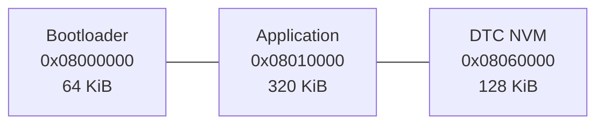

# STM32F407 车身控制 ECU：CAN、UDS、DTC 与 CAN Bootloader

这是一个基于 STM32F407VET6 的车身控制 ECU 教学项目。PC 通过 CANable 充当诊断仪，STM32 应用程序完成车灯控制、故障诊断和 DTC 管理；独立 Bootloader 通过 ISO-TP/UDS 接收 BIN 固件并写入片内 Flash。

当前版本已经走通从应用进入编程会话、复位到 Bootloader、传输完整固件、CRC 校验、再次复位并启动新应用的闭环。

## 已实现功能

| 模块 | 功能 |
|---|---|
| CAN 应用通信 | 500 kbit/s、标准帧；`0x123` 心跳、`0x200` 命令、`0x201` 应答 |
| 车灯控制 | PA7 低电平点亮；支持 CAN 开关灯与 PE3 按键故障注入 |
| UDS 应用服务 | `0x10` 会话控制、`0x3E` TesterPresent、`0x22 F186` 当前会话、`0x19 02` 读取 DTC、`0x14 FFFFFF` 清除 DTC |
| DTC 管理 | 模拟灯输出故障 `B1000-01`；当前失败与确认状态；Sector 7 掉电保存与恢复 |
| CAN Bootloader | 应用有效性检查、VTOR/MSP 移交、ISO-TP 重组、Flash 擦写、CRC-32、ECU Reset |
| UDS 下载服务 | `0x34 RequestDownload`、`0x36 TransferData`、`0x37 RequestTransferExit`、`0x11 ECUReset` |
| PC 工具 | python-can + SLCAN；命名测试菜单、BIN 自动升级、进度显示、CRC 计算、心跳验收 |

> 本项目面向学习与作品展示，尚未实现 SecurityAccess、固件签名、A/B 分区和掉电回滚，不应直接作为量产 ECU Bootloader 使用。

## 硬件与连接

- STM32F407VET6 开发板
- SN65HVD230 CAN 收发器
- CANable 2.0 S（SLCAN）
- 总线两端各 120 Ω 终端电阻，断电测量 CANH 与 CANL 约为 60 Ω
- ST-Link（首次烧录和调试）

| STM32 / 模块 | 连接 |
|---|---|
| PB9 / CAN1_TX | SN65HVD230 D / TXD |
| PB8 / CAN1_RX | SN65HVD230 R / RXD |
| SN65HVD230 CANH / CANL | CANable CANH / CANL |
| GND | STM32、SN65HVD230、CANable 必须共地 |
| PA7 | 车灯 LED，低电平点亮 |
| PE3 | 故障注入按键，低电平按下 |

CAN 位时序：APB1 40 MHz，Prescaler 5，BS1 13 TQ，BS2 2 TQ，SJW 1 TQ，波特率 500 kbit/s，采样点 87.5%。

| CAN ID | 方向 | 用途 |
|---:|---|---|
| `0x123` | ECU → PC | 应用程序心跳 |
| `0x200` | PC → ECU | 自定义车灯控制命令 |
| `0x201` | ECU → PC | 自定义命令应答 |
| `0x7E0` | PC → ECU | UDS / ISO-TP 请求 |
| `0x7E8` | ECU → PC | UDS 响应与 ISO-TP 流控 |

## 仓库结构

```text
CAN/
├─ F407_Body_ECU/              # 应用程序工程（链接到 0x08010000）
│  ├─ App/                     # 手写业务代码
│  │  ├─ Inc/
│  │  └─ Src/
│  ├─ Core/                    # CubeMX 生成的入口、外设和中断代码
│  ├─ Drivers/                 # STM32 HAL / CMSIS
│  ├─ F407_Body_ECU.ioc
│  └─ STM32F407XX_FLASH.ld
├─ F407_CAN_Bootloader/        # Bootloader 工程（链接到 0x08000000）
│  ├─ APP/                     # CAN、ISO-TP、UDS 与 Flash 升级代码
│  ├─ Core/
│  ├─ Drivers/
│  ├─ F407_CAN_Bootloader.ioc
│  └─ STM32F407XX_FLASH.ld
├─ tools/
│  ├─ can_test.py              # PC 诊断与自动升级工具
│  ├─ requirements.txt
│  └─ cangaroo/                # 早期 CANgaroo 测试配置
├─ docs/
│  ├─ flash-layout.md
│  ├─ firmware-update-flow.md
│  ├─ diagrams/                # draw.io 源图与实验参考图
│  └─ archive/                 # 历史阶段记录
├─ .gitignore
└─ README.md
```

两个 STM32CubeMX 工程保持独立，避免打乱各自的 `.ioc`、启动文件、链接脚本和 CMake 配置。`build/`、`.idea/`、ELF/BIN/MAP 等本机构建产物由 `.gitignore` 排除。

## Flash 分区



详细扇区、边界和设计原因见 [Flash 分区说明](docs/flash-layout.md)。

## 首次烧录

1. 分别编译 `F407_CAN_Bootloader` 与 `F407_Body_ECU`。
2. 通过 ST-Link 烧录 Bootloader ELF；其链接地址为 `0x08000000`。
3. 烧录 Application ELF；其链接地址为 `0x08010000`。
4. 复位后，Bootloader 检查应用向量表并跳转，CANable 应能收到 `0x123` 心跳。

Application 编译后会在 `F407_Body_ECU/build/Debug/` 生成用于 CAN 升级的 `F407_Body_ECU.bin`。

## 使用 PC 工具升级

PC 端需要 Python 3.10 或更高版本。在项目根目录运行：

```powershell
python -m pip install -r .\tools\requirements.txt
python .\tools\can_test.py
```

运行前停止 CANgaroo，确保 COM17 （你的CANableCOM端口号）没有被其他程序占用。若端口或 BIN 路径不同：

```powershell
python .\tools\can_test.py `
  --port COM17 `
  --firmware .\F407_Body_ECU\build\Debug\F407_Body_ECU.bin
```

进入菜单后选择 `u`。工具会自动完成：

```text
0x10 03 → 0x10 02 → 复位进入 Bootloader
→ 0x34 擦除并申请下载
→ 0x36 分块传输完整 BIN
→ 0x37 CRC 校验
→ 0x11 01 复位
→ 等待 0x123 心跳确认新应用启动
```

详细时序见 [固件升级流程](docs/firmware-update-flow.md)，PC 工具参数见 [tools/README.md](tools/README.md)。

## 验收现象

- 应用运行时：CANable 周期收到 ID `0x123`、DLC 8 的心跳帧，其中字节 4、5 为 `A5 5A`。
- UDS 下载成功：依次收到 `0x74`、每块 `0x76 BSC`、`0x77` 和 `0x51 01`。
- 复位完成：PC 工具再次检测到 `0x123` 心跳。
- DTC 持久化：确认故障后断电重启，`0x19 02` 仍能读取；执行 `0x14 FFFFFF` 后清除。

## 主要代码入口

- Application：`F407_Body_ECU/App/Src/can_app.c`
- 车灯控制：`F407_Body_ECU/App/Src/body_control.c`
- DTC 管理：`F407_Body_ECU/App/Src/DTC_manager.c`
- Bootloader CAN / ISO-TP：`F407_CAN_Bootloader/APP/Src/Bootloader_can.c`
- Bootloader UDS / Flash：`F407_CAN_Bootloader/APP/Src/Bootloader_uds.c`
- PC 工具：`tools/can_test.py`
