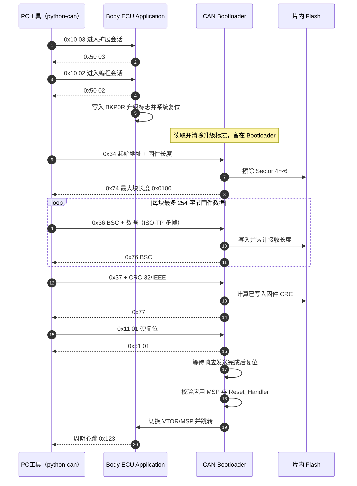
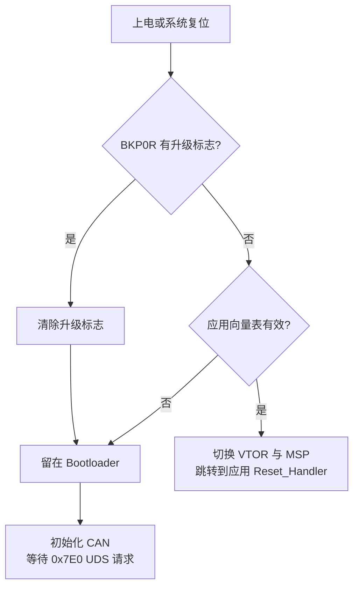

# CAN 固件升级流程

PC 工具通过 CANable 发送 UDS 请求。应用程序负责进入编程会话并复位到 Bootloader；Bootloader 负责擦除、接收、写入、CRC 校验和重新启动应用程序。

## 启动决策

## 各层分工

| 层 | 主要职责 |
|---|---|
| 经典 CAN | 使用 11 位标准数据帧传输；诊断请求 ID `0x7E0`，响应 ID `0x7E8` |
| ISO-TP | 把超过 7 字节的 UDS 消息拆成首帧和连续帧，并使用流控帧协调发送 |
| UDS | `0x34` 建立下载、`0x36` 传输数据、`0x37` 结束并校验、`0x11` 复位 |
| Flash | 擦除应用扇区、按地址写入固件、从 Flash 重新计算 CRC |
| PC 工具 | 读取 BIN、计算 CRC、自动分块/编号、检查每一步响应并验证应用心跳 |

## 关键约束

- `0x74 20 01 00` 中的 `0x0100` 表示一条完整 `TransferData` 请求最多 256 字节；扣除 SID 与 BSC 后，每块固件数据最多 254 字节。
- BSC（Block Sequence Counter）必须逐块递增，ECU 用它检测块丢失或乱序。
- CRC 使用 CRC-32/IEEE，与 Python `zlib.crc32()` 的结果一致。
- Bootloader 必须先发送 `0x51 01`，确认 CAN 邮箱不再 pending 后才能复位，否则 PC 可能收不到肯定响应。
- 若应用无效或 ECU 已经停在 Bootloader，PC 工具会跳过应用会话切换，直接尝试 `0x34`。
