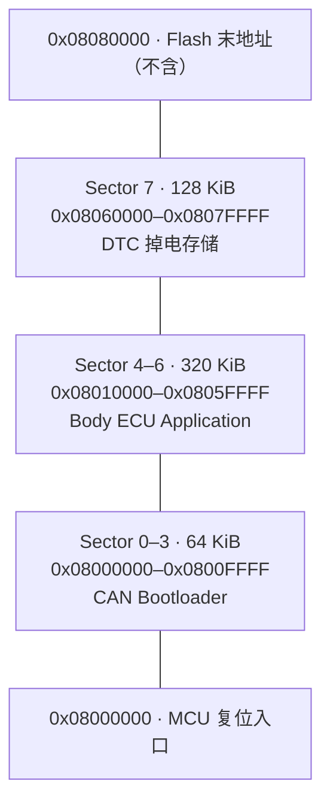

# Flash 分区

STM32F407VET6 片内 Flash 容量为 512 KiB。本项目把 Bootloader、应用程序和 DTC 掉电存储严格分开，应用链接脚本不会占用 DTC 扇区，Bootloader 升级时也只擦除应用区。

| 区域 | 扇区 | 起始地址 | 结束地址（含） | 大小 | 用途 |
|---|---:|---:|---:|---:|---|
| Bootloader | 0–3 | `0x08000000` | `0x0800FFFF` | 64 KiB | 上电入口、应用校验、CAN/ISO-TP/UDS 升级、应用跳转 |
| Application | 4–6 | `0x08010000` | `0x0805FFFF` | 320 KiB | 车身 ECU 应用程序和应用向量表 |
| DTC NVM | 7 | `0x08060000` | `0x0807FFFF` | 128 KiB | DTC 有效标志与确认状态掉电保存 |

## 代码中的边界

- Bootloader 链接地址：`0x08000000`，最大 64 KiB。
- Application 链接地址：`0x08010000`，最大 320 KiB。
- Application 的 `SCB->VTOR` 偏移：`0x00010000`。
- Bootloader 允许的下载范围：`0x08010000` 到 `0x08060000`（结束地址不含）。
- `0x34 RequestDownload` 成功校验后擦除 Sector 4、5、6；不会擦除 Sector 7。
- DTC Magic：`0x08060000`；DTC 状态：`0x08060004`。

## 为什么这样划分

1. MCU 每次复位都从 `0x08000000` 开始执行，因此 Bootloader 必须放在最前面。
2. 应用从 `0x08010000` 开始，正好位于 Sector 4 的起点，升级时可以完整擦除 Sector 4～6。
3. DTC 独占 Sector 7，升级应用程序不会丢失已确认故障。
4. Bootloader 在跳转前检查应用首个字（初始 MSP）和第二个字（`Reset_Handler`）是否合法，避免跳入空 Flash。
